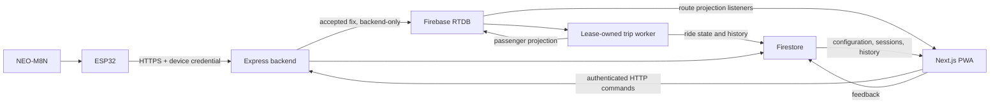

# Eki campus bus tracking

Last updated: 2026-10-29 03:04 IST (UTC+05:30).

Eki lets passengers find a campus bus, choose a destination, join a ride and follow its progress. Administrators manage routes, fleet assignments, ride operations, feedback and history.

An ESP32 with a NEO-M8N GNSS receiver sends authenticated HTTPS telemetry to the Express backend. The backend keeps live state in Firebase Realtime Database (RTDB) and publishes a passenger-safe projection from it; Firestore stores configuration, ride recovery and history. The Next.js frontend is a static-export progressive web app (PWA).

## Start here

| Your task | Read |
|---|---|
| First-time setup and role workflows | [Getting started](docs/GETTING_STARTED.md) |
| Environment variables and authentication | [Configuration](docs/CONFIGURATION.md) |
| Find a technical or operational document | [Documentation index](docs/index/README.md) |
| Understand the system design | [Architecture](docs/design/ARCHITECTURE.md) and [data model](docs/data/FIREBASE_DATA_MODEL.md) |
| Frontend work | [Frontend guide](frontend/README.md) |
| Backend work | [Backend guide](backend/README.md) and [API reference](backend/API.md) |
| Prepare an ESP32 tracker | [Hardware guide](hardware/README.md) and [telemetry contract](docs/hardware/HARDWARE_TELEMETRY.md) |
| Automatic ride startup | [Automatic GNSS service](docs/operations/AUTOMATIC_GNSS_SERVICE.md) |
| Phone testing, tunnel recovery or a demo | [Local testing](docs/operations/LOCAL_TESTING.md), [ngrok tunnel](docs/operations/NGROK_TUNNEL.md) and [demo runbook](docs/operations/LIVE_DEMO_RUNBOOK.md) |
| Contribute a change | [Contributing](CONTRIBUTING.md) |

## Run locally

Use Node.js 24 (the CI version), npm, Git, and a dedicated development Firebase project. Java 21 is needed for rule tests; PlatformIO is needed for firmware work.

Run from the repository root:

```powershell
npm ci
Copy-Item backend/.env.example backend/.env
Copy-Item frontend/env.production.example frontend/.env.local
```

Edit both ignored files before starting:

- Backend: set `NODE_ENV=development`, `PORT=4000`, `CORS_ORIGIN=http://localhost:3000`, the development RTDB URL and Firebase Admin credentials. Keep `RETENTION_SWEEPER_ENABLED=false` locally. The tracked backend template uses production mode and port `8080`; copying it unchanged will not start a usable local environment.
- Frontend: set the matching Firebase values, Maps values and `NEXT_PUBLIC_BACKEND_URL=http://localhost:4000`. `NEXT_PUBLIC_*` values are compiled into the bundle, so restart the dev server after changing them.
- App Check is not used. If App Check enforcement is enabled on the Firebase project, disable it; see [Auth configuration](docs/CONFIGURATION.md#local-auth-setup).

```powershell
npm run dev
```

Open `http://localhost:3000`. Check `http://localhost:4000/health`; HTTP `200` with `{"status":"ok"}` means both Firebase dependency probes are ready. A `503` means the process is running with degraded dependencies. `/live` reports only that the process is up.

Follow [getting started](docs/GETTING_STARTED.md#create-initial-development-data) to create profiles, routes, buses and driver assignments. A phone or ESP32 needs a reachable HTTPS backend origin; its `localhost` points to itself.

## How data moves



- The protected device registry supplies the bus and route assignment. Hardware cannot choose its assignment or write Firebase directly.
- Routine service starts automatically from a qualified device GNSS fix on a fully assigned bus and route. Manual start and resume remain available through the protected session API. Device presence alone does not mean passenger service has started.
- The backend advances only the next ordered stop. The final stop completes a ride; ending it early records `interrupted`. GNSS or network loss changes signal state, never ride progress.
- A bus lock prevents concurrent rides on one physical bus. Durable ride state supports recovery after network, browser, device or backend interruptions. One backend instance at a time runs the trip worker, elected through a fenced Firestore lease.
- Browsers never read raw live state. Passengers subscribe to a per-route projection; routes, ETAs and boarding require an active ride with a resolved direction, and a pending direction never defaults to forward.
- Passengers join a ride without a boarding code; account, stop and proximity checks still apply.
- Administrator access requires trusted `role: "admin"` and `admin: true` claims plus a current authorization version. A Firestore profile alone grants nothing.
- Feedback submission, the admin latest-200 list and status updates go directly to Firestore under security rules, so they work while the backend is offline. Other commands and mutations use authenticated HTTP endpoints.

See [architecture](docs/design/ARCHITECTURE.md), [data model](docs/data/FIREBASE_DATA_MODEL.md) and [telemetry contract](docs/hardware/HARDWARE_TELEMETRY.md) for the full behavior.

## Repository map

| Path | Purpose |
|---|---|
| `frontend/` | Passenger/admin UI, authentication, Firebase subscriptions and PWA |
| `backend/` | Device ingestion, authenticated APIs, ride lifecycle, background jobs and admin CLIs |
| `hardware/` | ESP32 firmware, configuration templates and native policy tests |
| `docs/` | Onboarding, contracts, operations, dated acceptance evidence and generated mirrors of Markdown files outside `docs/` |
| `e2e/` | Playwright browser suites with synthetic Firebase and Maps adapters |
| `qa/` | Acceptance maps linking requirements to tests, and evidence guides |
| `scripts/` | Build, CSP, API verification, documentation sync, QA tooling and trace analysis |
| `tools/` | Local build tooling |
| `observability/` | Optional local Collector/Jaeger stack and dashboard configuration |
| `.github/workflows/` | CI verification and controlled Hosting/rules deployments |
| `firestore.rules`, `database.rules.json` | Firebase client authorization |

## Verify a change

```powershell
npm run verify
```

This runs lint, software tests, build/export, service-worker/CSP generation and the production dependency audit. Run the affected checks separately when relevant:

| Command | When |
|---|---|
| `npm run test:rules` | Firestore or RTDB rules changes (requires Java 21) |
| `npm run test:e2e:admin` | Admin browser flows (run `npx playwright install chromium` first) |
| `npm run docs:sync` | After editing any tracked Markdown file outside `docs/` |
| `npm run qa:check` | After renaming or removing tests referenced by `qa/` maps |

[Test strategy](docs/testing/TEST_STRATEGY.md) explains each command and what it proves. A build regenerates the CSP hashes in `firebase.json`; do not edit them by hand.

CI (`Production verification`) runs on every push and pull request. See [Contributing](CONTRIBUTING.md) for the branch to target and the [release guide](docs/operations/CI_CD_AND_RELEASES.md) for the deployment flow.

## Deployment

A verified push to `main` deploys Firebase Hosting, Firestore and RTDB rules, and Firestore indexes to staging. Production deploys run only by manual dispatch from `main` and require an approving reviewer. CI does not deploy the backend; it currently runs as a single process on one host, exposed through an [ngrok tunnel](docs/operations/NGROK_TUNNEL.md).

A production release also needs owned backend infrastructure, approved retention, monitoring/backups, protected firmware provisioning and field acceptance. Use the [deployment checklist](docs/operations/UNIVERSITY_DEPLOYMENT_CHECKLIST.md) and [current acceptance index](docs/testing/README.md).

Keep credentials and personal/location evidence in approved private storage. See [security policy](SECURITY.md).

## License

Copyright (c) 2026 Eki Bus Tracking Project. Licensed under the [MIT License](LICENSE).
